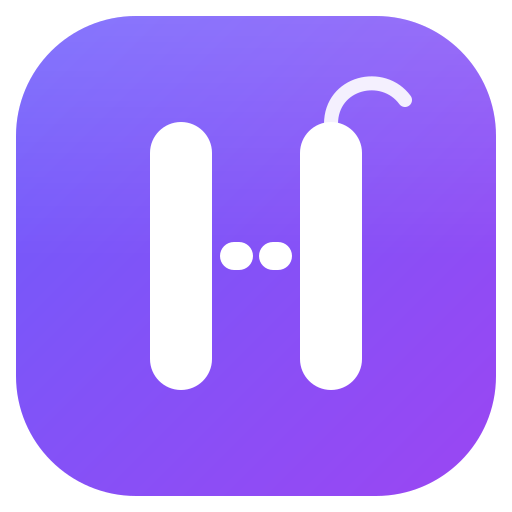

<p align="center"></p>
<h1 align="center">Hilvan</h1>
<p align="center">Cliente de <a href="https://matrix.org">Matrix</a> minimalista, rápido y seguro — para Linux, Windows, macOS y Android.</p>

Hilvan une lo mejor de Element, Cinny, FluffyChat y Nheko con funciones al estilo de Discord y lo
que ofrecen Synapse Pro / Element Enterprise:

- Cifrado de extremo a extremo, verificación con emojis, respaldo de claves.
- Varias cuentas a la vez, espacios, hilos, encuestas, stickers, búsqueda (también en mensajes cifrados).
- Llamadas y videollamadas, compartir pantalla con resolución, FPS y audio a elección (escritorio).
- Archivos de cualquier tamaño con reanudación y verificación; visor de fotos y videos.
- Bandeja del sistema, íconos a elección, actualizaciones automáticas **firmadas**.
- Para organizaciones: políticas, retención, exportación para auditoría, SCIM, panel de
  administración, módulo de NixOS "Hilvan Server" (ver [docs/organizaciones.md](docs/organizaciones.md)).

## Descargar

En [**Versiones**](../../releases/latest):

| Sistema | Archivo |
|---|---|
| Windows 10/11 | `hilvan-…-windows-x86_64.zip` (descomprimí y abrí `hilvan.exe`) |
| macOS 11+ (Apple Silicon / Intel) | `hilvan-…-macos-arm64.zip` / `…-macos-x86_64.zip` (arrastrá Hilvan.app a Aplicaciones; la primera vez: clic derecho → Abrir) |
| Linux, cualquier distribución | `hilvan-…-x86_64.flatpak` → `flatpak install --user hilvan-….flatpak` |
| Debian / Ubuntu / Mint | `hilvan_…_amd64.deb` (o `arm64`) |
| Otras (Fedora, Arch, openSUSE…) | `hilvan-…-linux-x86_64.tar.gz` → `./instalar.sh` (necesita GTK 4, WebKitGTK 6 y GStreamer) |
| NixOS | `inputs.hilvan.url = "github:ebalia-real/hilvan";` y `hilvan.packages.${system}.hilvan` |
| Android 10+ | `hilvan-….apk` |

Hilvan se actualiza solo (Ajustes → Acerca de → Actualizaciones). En Windows y macOS las
descargas no están firmadas por Microsoft/Apple, así que el sistema puede pedir confirmación la
primera vez; la integridad la garantiza la firma propia de Hilvan (ver [SECURITY.md](SECURITY.md)).

## Compilar

```bash
nix develop -c go build -tags goolm,sqlite_fts5 ./cmd/hilvan     # Linux (o con GTK 4, WebKitGTK 6 y GStreamer instalados)
nix develop .#android -c android/build.sh                          # Android
```

Windows y macOS se compilan en GitHub Actions (`.github/workflows/release.yml`). Para publicar una
versión: `scripts/publicar.sh X.Y.Z`.
